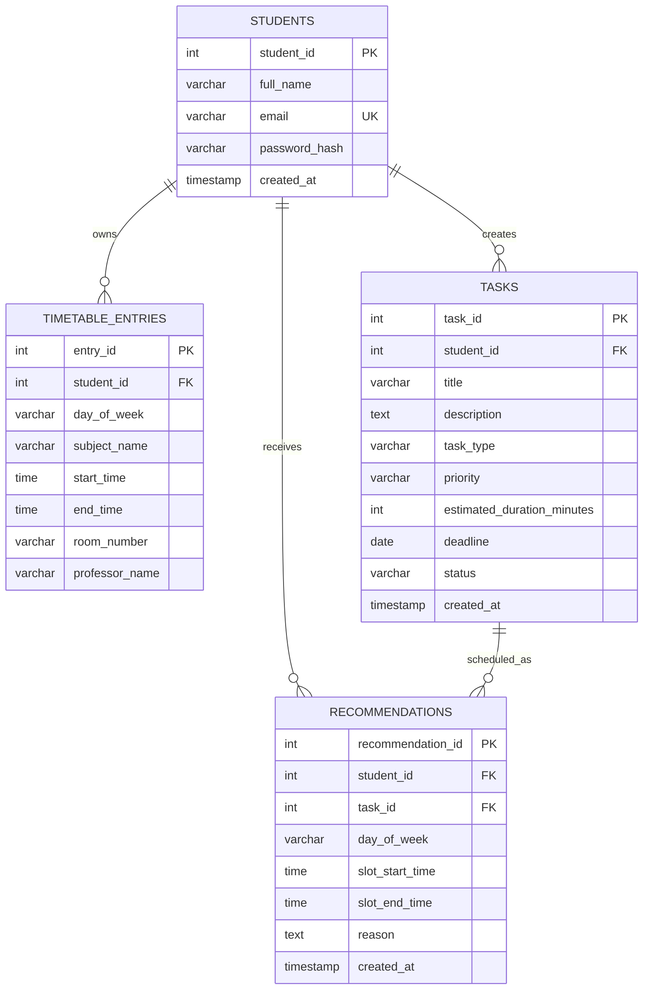

# SlotWise &mdash; Smart Academic Free-Time Utilization and Task Planning System

[](https://www.oracle.com/java/)
[](https://javaee.github.io/servlet-spec/)
[](https://www.mysql.com/)
[]()
[-success.svg)]()

> A full-stack Java web application engineered for college students to manage class timetables, track deadlines, automatically detect unoccupied free periods, and receive algorithmic study recommendations. Built as a comprehensive academic project demonstrating **Object-Oriented Programming (OOP)**, **Relational Database Management Systems (DBMS)**, and **Java Database Connectivity (JDBC)**.

---

## 1. Project Overview

College students often face fragmented daily schedules featuring multiple 30-to-90-minute gaps between lectures and lab sessions. Due to lack of structured planning, these free periods frequently go unused while coursework and assignments pile up until deadlines.

**SlotWise** bridges this gap:
- Students record their weekly class timetable (Monday &ndash; Saturday).
- Students log assignments, lab reports, and exam preparation goals.
- The system automatically detects all free periods between 8:00 AM and 6:00 PM.
- A deterministic, polymorphic prioritization engine pairs pending tasks with free periods, telling the student what to study and when.

---

## 2. Key Features

- **Weekly Timetable Management (CRUD):** Add, view, edit, and delete class sessions with day filtering and automatic collision/overlap detection.
- **Academic Coursework Tracker (CRUD):** Track assignments, lab tasks, and exam prep with status transitions (`PENDING`, `IN_PROGRESS`, `COMPLETED`), deadlines, and estimated durations.
- **Free Slot Discovery Engine:** Rule-based gap identification between class intervals within the academic day window (08:00 to 18:00) with a minimum 15-minute threshold.
- **Smart Study Planner:** Pairs free periods with top-priority academic tasks, generating tailored explanations for each recommendation.
- **Academic Progress Analytics:** Real-time metrics including total tasks, pending, in-progress, completed, overdue, and dynamic completion percentage.
- **Zero-JavaScript Architecture:** Fully functional using pure HTML5 forms, server-side Java Servlets, JSP/JSTL, and modern Vanilla CSS animations.
- **Enterprise Security:** Salted BCrypt password hashing (10 rounds), session invalidation on logout, authenticated access filters, and 100% parameterized JDBC queries preventing SQL injection.

---

## 3. Demonstration of Object-Oriented Programming (OOP)

SlotWise was intentionally architected to demonstrate all four pillars of OOP:

### A. Encapsulation
- **Implementation:** Class fields in `Student`, `TimetableEntry`, `Task`, and `Recommendation` are declared `private`.
- **Validation:** Setters enforce business constraints (e.g., student email format validation, password length checks, duration minimums, and timetable start time preceding end time).
```java
// Example from TimetableEntry.java
public void setStartTime(Time startTime) {
    if (startTime == null) throw new IllegalArgumentException("Start time cannot be null");
    if (this.endTime != null && startTime.after(this.endTime)) {
        throw new IllegalArgumentException("Start time must be before end time");
    }
    this.startTime = startTime;
}
```

### B. Inheritance
- **Implementation:** Base class `com.slotwise.model.Task` defines common coursework attributes (`taskId`, `studentId`, `title`, `description`, `taskType`, `priority`, `estimatedDurationMinutes`, `deadline`, `status`).
- **Subclasses:**
  - `AssignmentTask extends Task`: Represents homework assignments and project milestones.
  - `LabTask extends Task`: Represents laboratory experiments, manuals, and viva prep.
  - `ExamPreparationTask extends Task`: Represents mid-term and end-semester revisions.

### C. Polymorphism
- **Implementation:** Base class `Task` declares `calculatePriorityScore()` and `getTaskTypeLabel()`. Each subclass overrides these methods to inject category-specific weightings:
  - `AssignmentTask` adds a **+10 point submission deadline bonus**.
  - `LabTask` scales urgency based on experiment duration (+5 for short, +8 for long labs).
  - `ExamPreparationTask` weights multi-hour comprehensive review blocks (+15 for deep study).
- **Dynamic Method Dispatch:** When `SmartPlannerService` ranks tasks, it calls `task.calculatePriorityScore()` on base `Task` references; Java's JVM dynamically executes the corresponding subclass implementation at runtime.

### D. Abstraction
- **Implementation:** The `TaskSchedulingStrategy` interface defines the academic planning contract:
  ```java
  public interface TaskSchedulingStrategy {
      List<FreeTimeSlot> findFreeSlots(int studentId, String dayOfWeek);
      List<Recommendation> generateRecommendations(int studentId, String dayOfWeek);
      List<Task> rankTasksByPriority(List<Task> tasks);
  }
  ```
- `SmartPlannerService` implements this interface, isolating complex time math and sorting algorithms away from the presentation Servlets.

---

## 4. Relational Database Design (DBMS)

SlotWise utilizes MySQL with InnoDB tables, strict foreign keys, composite indexes, and integrity constraints.

### Entity-Relationship Diagram (ERD)



### Table Breakdown
1. **`students`**: User identity, unique email index, BCrypt password hash.
2. **`timetable_entries`**: Lecture schedules with `CHECK (start_time < end_time)` and composite index `(student_id, day_of_week, start_time)`.
3. **`tasks`**: Academic coursework with `CHECK (task_type IN ('ASSIGNMENT', 'LAB', 'EXAM_PREP'))` and `CHECK (status IN ('PENDING', 'IN_PROGRESS', 'COMPLETED'))`.
4. **`recommendations`**: Stored planning results with foreign keys cascading on student or task deletion.

---

## 5. Technology Stack

| Layer | Technology | Version | Purpose |
|---|---|---|---|
| **Language** | Java (JDK) | 11+ | Backend logic, OOP data models, services |
| **Server** | Apache Tomcat | 9.x | Java Servlet 4.0 & JSP 2.3 Web Container |
| **Database** | MySQL | 8.0+ | Relational storage, integrity constraints |
| **Driver** | MySQL Connector/J | 8.0.33 | JDBC connectivity |
| **Security** | jBCrypt | 0.4 | 10-round salted password hashing |
| **Presentation** | JSP & JSTL | 2.3 / 1.2 | Server-side templating without Java scriptlets |
| **Styling** | Vanilla CSS3 | &mdash; | Dark navy/purple theme, flexbox, CSS grid, CSS keyframes |
| **Build Tool** | Apache Maven | 3.8+ | Dependency management and `.war` packaging |

---

## 6. Project Directory Structure

```
SlotWise 1/
│
├── pom.xml                                      # Maven configuration & dependencies
├── .gitignore                                   # Git ignore rules
│
├── database/
│   ├── schema.sql                               # DDL: slotwise_db and table creation
│   └── seed.sql                                 # DML: Demo student, 15 classes, 8 sample tasks
│
└── src/
    └── main/
        ├── java/com/slotwise/
        │   ├── model/                           # OOP Domain Models
        │   │   ├── Student.java
        │   │   ├── Task.java                    # Base Task class
        │   │   ├── AssignmentTask.java          # Subclass 1
        │   │   ├── LabTask.java                 # Subclass 2
        │   │   ├── ExamPreparationTask.java     # Subclass 3
        │   │   ├── TimetableEntry.java
        │   │   ├── FreeTimeSlot.java
        │   │   ├── Recommendation.java
        │   │   ├── TaskFactory.java             # Factory Pattern
        │   │   └── TaskSchedulingStrategy.java  # Abstraction Interface
        │   │
        │   ├── dao/                             # Data Access Objects (JDBC CRUD)
        │   │   ├── StudentDAO.java
        │   │   ├── TaskDAO.java
        │   │   ├── TimetableDAO.java
        │   │   └── RecommendationDAO.java
        │   │
        │   ├── service/                         # Business Logic & Algorithms
        │   │   ├── AuthService.java
        │   │   ├── SmartPlannerService.java
        │   │   └── ProgressService.java
        │   │
        │   ├── servlet/                         # HTTP Controllers (MVC)
        │   │   ├── LoginServlet.java
        │   │   ├── RegisterServlet.java
        │   │   ├── LogoutServlet.java
        │   │   ├── DashboardServlet.java
        │   │   ├── TaskServlet.java
        │   │   ├── TimetableServlet.java
        │   │   ├── PlannerServlet.java
        │   │   ├── ProgressServlet.java
        │   │   └── SettingsServlet.java
        │   │
        │   └── util/                            # Utilities
        │       └── DBConnection.java            # JDBC connection manager
        │
        ├── resources/
        │   └── application.properties.example   # DB configuration template
        │
        └── webapp/                              # Web Presentation (Views & Styles)
            ├── css/
            │   └── style.css                    # Dark theme, animations, responsive design
            ├── WEB-INF/
            │   └── web.xml                      # Servlet mappings, session timeout, error pages
            ├── index.jsp                        # Public landing page with mockup preview
            ├── login.jsp                        # Sign in form
            ├── register.jsp                     # Student registration form
            ├── dashboard.jsp                    # Student overview dashboard
            ├── tasks.jsp                        # Task management CRUD & filters
            ├── timetable.jsp                    # Timetable schedule CRUD & day tabs
            ├── planner.jsp                      # Free periods & recommendation engine
            ├── progress.jsp                     # Progress metrics & breakdown table
            ├── settings.jsp                     # Profile & BCrypt password update
            └── error.jsp                        # 404/500 error view
```

---

## 7. Setup & Installation Guide

### Prerequisites
1. **JDK 11** or higher installed (`java -version`).
2. **Apache Maven 3.8+** installed (`mvn -version`).
3. **MySQL Server 8.0+** running locally.
4. **Apache Tomcat 9.0+** installed.

---

### Step 1: Database Setup
Open your MySQL terminal or MySQL Workbench:

```bash
# 1. Log into MySQL
mysql -u root -p

# 2. Run the schema creation script
source /path/to/SlotWise 1/database/schema.sql;

# 3. (Recommended) Seed demo student data
source /path/to/SlotWise 1/database/seed.sql;
```

---

### Step 2: Configure Database Credentials
Create your `application.properties` configuration file in `src/main/resources/`:

```properties
# src/main/resources/application.properties
db.url=jdbc:mysql://localhost:3306/slotwise_db?useSSL=false&allowPublicKeyRetrieval=true&serverTimezone=UTC
db.user=root
db.password=YOUR_MYSQL_PASSWORD
```
*(Note: If `application.properties` is absent, `DBConnection.java` defaults to `localhost:3306/slotwise_db`, user `root`, password empty).*

---

### Step 3: Compile & Build the WAR
In the project root directory:

```bash
mvn clean package
```
This compiles all Java source files and produces `target/SlotWise.war`.

---

### Step 4: Deploy to Apache Tomcat
1. Copy `target/SlotWise.war` into your Tomcat installation directory's `webapps/` folder:
   ```bash
   cp target/SlotWise.war /path/to/apache-tomcat-9.0.x/webapps/
   ```
2. Start Tomcat:
   ```bash
   # Windows:
   bin\startup.bat

   # Linux/macOS:
   ./bin/startup.sh
   ```
3. Open your web browser and navigate to:
   ```
   http://localhost:8080/SlotWise/
   ```

---

## 8. Demo Credentials & Test Accounts

| Field | Value |
|---|---|
| **Demo Email** | `demo@slotwise.com` |
| **Demo Password** | `demo123` |
| **Name** | Alex Henderson |
| **Pre-populated Data** | 15 timetable entries (Mon&ndash;Fri), 8 academic tasks |

---

## 9. Scheduling Algorithm Details

`SmartPlannerService` executes a deterministic 3-stage algorithm:

1. **Free Slot Identification:**
   - Academic day boundaries: `08:00` to `18:00`.
   - Fetches the student's sorted lectures for the selected day.
   - Computes interval between 08:00 and first lecture.
   - Computes interval between each consecutive lecture.
   - Computes interval between last lecture and 18:00.
   - Filters out any gap shorter than 15 minutes.

2. **Polymorphic Priority Ranking:**
   - Tasks are evaluated with `task.calculatePriorityScore()`:
     - Base score: High = 30, Medium = 20, Low = 10.
     - Deadline urgency bonus: Due today (+25), Due within 2 days (+15), Due within 5 days (+5).
     - Subclass polymorphic bonus: Assignment (+10), Lab (+5 to +8), Exam Prep (+15).

3. **Greedy Matching & Reason Synthesis:**
   - Tasks are mapped to slots where `slot.durationMinutes >= task.estimatedDurationMinutes`.
   - If a task is longer than any single slot, it is matched with a note to make progress.
   - Records are saved in the `recommendations` table with clear explanations for why that slot was chosen.

---

## 10. Security Implementation

- **Password Protection:** Uses **BCrypt** with an automatically generated salt and cost factor of 10 (`BCrypt.hashpw(password, BCrypt.gensalt(10))`). Raw passwords are never stored.
- **SQL Injection Prevention:** Every database query in all DAO classes uses `java.sql.PreparedStatement` with `?` placeholders. No dynamic string concatenation is used for SQL commands.
- **Session Security:** 
  - Standard session timeout of 30 minutes defined in `web.xml`.
  - Servlets verify session existence and `studentId` attribute presence before fulfilling protected operations.
  - Logging out invalidates the `HttpSession` and redirects to the landing page.

---

## 11. Zero-JavaScript Technical Rationale

This project adheres to a strict **Zero-JavaScript** requirement:
- All interactive actions (login, registrations, creating tasks, editing timetables, toggling task status) submit native HTML forms directly to Java Servlets via HTTP `GET` or `POST`.
- Navigation, day tabs, and task filtering use standard query parameters (`?day=Monday`, `?status=PENDING`).
- Progress bars and meters are rendered using CSS width percentages (`width: ${completionPercentage}%`) and CSS keyframe animations.
- Hover transitions, glowing effects, and responsive breakpoints are powered entirely by modern CSS3.

---

## 12. College Evaluation & Viva Q&A Guide

### Q1: How does your application implement Polymorphism?
> **Answer:** The base class `Task` defines `calculatePriorityScore()`. Subclasses `AssignmentTask`, `LabTask`, and `ExamPreparationTask` each override this method to add their own weighting logic. In `SmartPlannerService.rankTasksByPriority()`, we invoke `task.calculatePriorityScore()` on base `Task` references. Java's JVM dynamically determines the actual object type at runtime and executes the correct subclass implementation.

### Q2: How did you prevent SQL Injection?
> **Answer:** We used JDBC `PreparedStatement` with parameterized queries across all DAO classes (`StudentDAO`, `TaskDAO`, `TimetableDAO`, `RecommendationDAO`). User inputs are treated strictly as literal parameter values rather than executable SQL code.

### Q3: How are class collisions detected in the timetable?
> **Answer:** In `TimetableDAO.hasOverlap()`, when adding or editing a session, the system runs a SQL query:
> `WHERE student_id = ? AND day_of_week = ? AND start_time < ? AND end_time > ?`
> If an overlapping interval exists, `TimetableServlet` blocks creation and alerts the user with an error message.

### Q4: What design pattern did you use to instantiate tasks from the database?
> **Answer:** We implemented the **Factory Pattern** in `TaskFactory.createTask(taskType)`. When reading records from the `tasks` table, `TaskDAO` passes the `task_type` column to the factory, which returns the appropriate subclass instance (`AssignmentTask`, `LabTask`, or `ExamPreparationTask`).

---

## 13. License

Developed for academic demonstration purposes. Free to use and inspect for college coursework and university evaluations.
